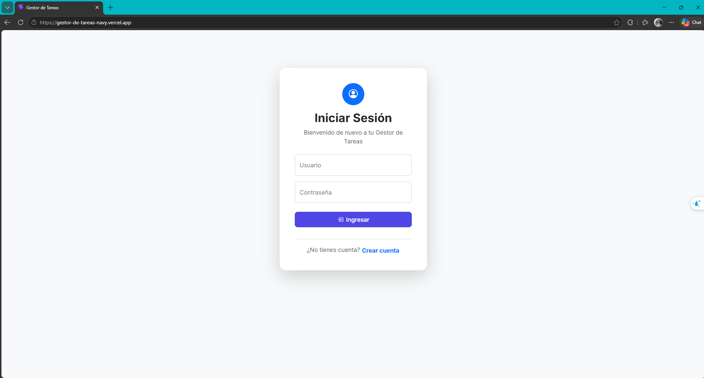
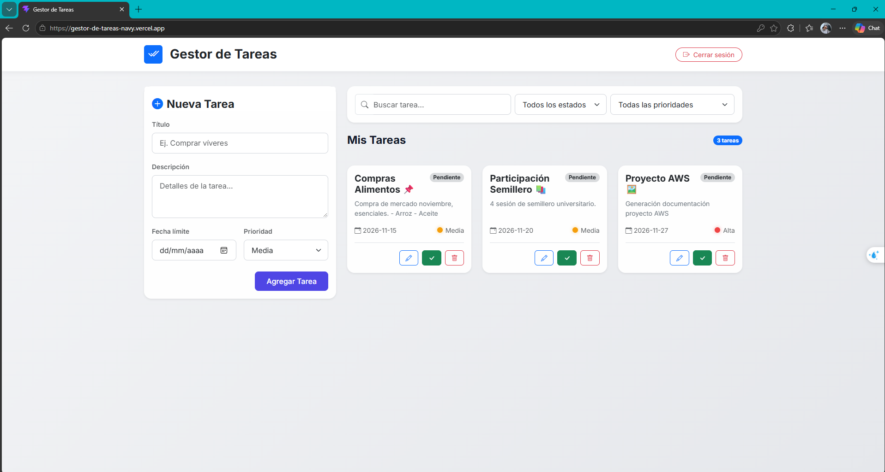
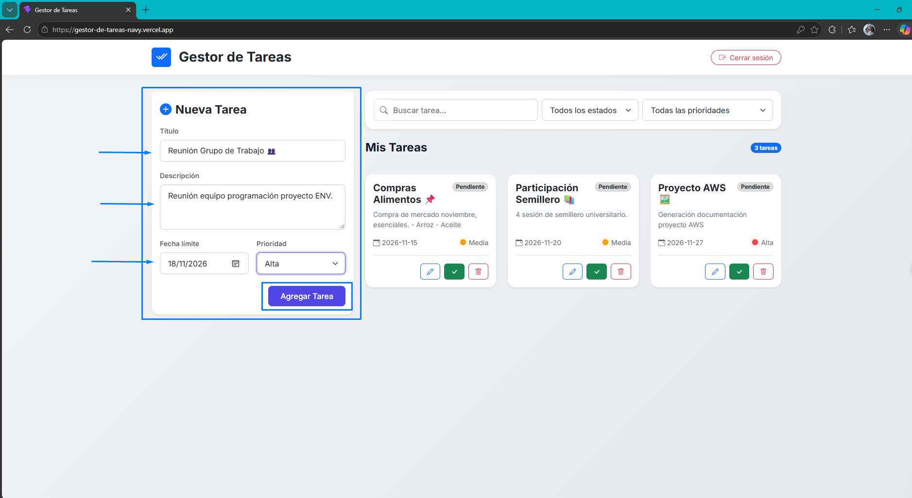
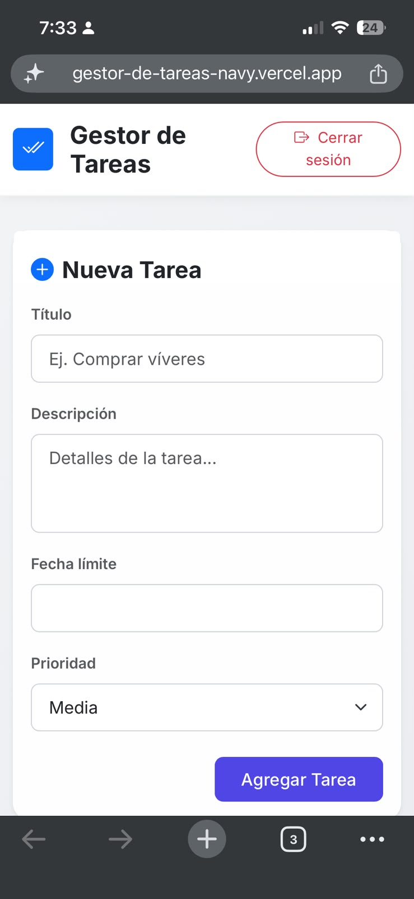

# Gestor de Tareas

Aplicación full stack para gestionar tareas personales, inspirada en Microsoft To Do. Cada usuario se registra, inicia sesión y administra solo sus propias tareas.

🔗 **Demo:** [gestor-de-tareas-navy.vercel.app](https://gestor-de-tareas-navy.vercel.app/)

> El backend está en un plan gratuito de Render: la primera petición puede tardar unos segundos mientras el servicio se activa.

## Capturas

| Inicio de sesión | Lista de tareas |
|---|---|
|  |  |

| Crear tarea | Vista móvil |
|---|---|
|  |  |

## Tecnologías

- **Frontend:** React 19 · Vite · React Router · Bootstrap
- **Backend:** Node.js 20 · Express 5 · SQLite
- **Seguridad:** autenticación con JWT · contraseñas cifradas con bcrypt
- **Despliegue:** Vercel (frontend) · Render (backend)

## Funcionalidades

- Registro e inicio de sesión de usuarios
- Crear, ver, editar y eliminar tareas
- Cada tarea tiene título, descripción, fecha límite, prioridad y estado
- Cada usuario solo puede ver y modificar sus propias tareas

## Estructura

```
gestor_tareas/
├── frontend/   # App React (ver frontend/README.md)
└── backend/    # API REST con Express y SQLite (ver backend/README.md)
```

## Cómo correrlo en local

Necesitas Node.js 20 o superior. Levanta primero el backend y luego el frontend; las instrucciones de cada uno están en su README:

1. [Backend](backend/README.md)
2. [Frontend](frontend/README.md)

## Limitaciones conocidas

- La base de datos es un archivo SQLite. En el plan gratuito de Render el disco es temporal, así que los datos pueden perderse cuando el servicio se reinicia o se vuelve a desplegar.
- No hay pruebas automáticas todavía.

## Próximos pasos

- Migrar a una base de datos externa (por ejemplo PostgreSQL)
- Agregar pruebas automáticas al backend
- Validar los datos de entrada y limitar los intentos de login

## Autor

Santiago Cogollo Peña · [LinkedIn](https://www.linkedin.com/in/santiago-cogollo-96196a260)